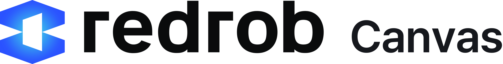

<picture>
  <source media="(prefers-color-scheme: dark)" srcset="resources/brand/redrob-canvas-lockup-white.png">
  
</picture>

# 레드롭 캔버스

[English](./README.md) · **한국어**

레드롭 캔버스는 에이전틱 그래픽 편집기입니다. 사진, 벡터, 페이지 레이아웃을 한 창에서 다루고, 세 모드를
가로지르는 AI 도구 층과 문서를 옆에서 함께 편집하는 에이전트가 있습니다.

데스크톱 애플리케이션 하나(`apps/redrob-canvas`, Rust와 egui)에 세 모드가 있고, 각 모드는
편집기 하나를 통째로 담습니다. 편집기는 `editors/` 아래에 있고 소스에서 빌드합니다
(코드 출처: SOURCE_ORIGINS.md, NOTICE).

| 모드 | 종류 | 용도 |
| --- | --- | --- |
| **Photo** | 래스터 | 레이어, 마스크, 조정 레이어, 레이어 스타일, 브러시, 문자, 색 관리; 실제 PSD 파일 |
| **Vector** | 벡터 | 패스, 불리언, 패스 위 문자, 그레이디언트, 아트보드; SVG, AI, EPS, PDF, DXF |
| **Layout** | 페이지 레이아웃 | 마스터 페이지, 이어지는 텍스트 프레임, 하이픈 처리; IDML, PDF, PPTX, EPUB |

셸은 창, 모드 전환(`Ctrl+1` / `Ctrl+2` / `Ctrl+3`, 또는 `--mode photo|vector|layout`), 하나의 설정
디렉터리(`ai.redrob.canvas`), 그리고 에이전트를 맡습니다. 모드를 바꿔도 각 편집기에 열려 있던 문서는
그대로 남습니다. 세 편집기가 공유하는 도킹, 색 관리, 인쇄 코드는
`editors/shared`에 있습니다.

같은 실행 파일이 명령줄로도 동작합니다. `redrob-canvas photo|vector|layout ARGS`는 창을 열지 않고
변환, 정보 보기, 명령 묶음 실행, stdio MCP 서버를 합니다(`redrob-canvas photo --help`).

## AI 도구와 에이전트

두 층이 특정 모드 안이 아니라 모드 전체를 가로지릅니다.

- **에이전트**(`crates/redrob-agent`): 모델이 타입이 있는 도구 호출로 문서를 편집하고, 각 호출은 적용 전에
  검토할 수 있는 채팅 패널입니다. **Redrob Code가 필요합니다.** 에이전트는 이 컴퓨터에 하나 있는 공유
  Redrob Code 데몬(`~/.redrob/run/server.json`, 없으면 `redrob service start`)의
  `<daemon>/v1/chat/completions`에 OpenAI 호환 스트리밍으로 말하고, 요청마다 `x-redrob-app: canvas`를
  실어 보냅니다. Redrob 콘솔 키는 데몬이 보관하며, 이 앱은 자체 키를 갖지 않고 콘솔로 직접 가는 경로도
  없습니다. 로그인은 Redrob Code, Redrob Launcher, 또는 여기서 한 번만 하면 됩니다. Redrob Code가 없으면
  패널이 그렇게 말하고 [런처 최신 릴리스](https://github.com/redrob-labs/redrob-launcher/releases/latest)
  링크를 보여 줍니다.
- **AI 도구**(`crates/redrob-ai`, 0.7에서 진행 중): 인페인트, 아웃페인트, 지우기, 업스케일, 배경 제거,
  피사체 선택을 앱이 직접 설치해 `127.0.0.1`에서 돌리는 로컬 IOPaint 엔진으로 처리하고, Vector 모드에는
  벡터화를 더합니다. 모든 것이 이 컴퓨터에서 돌고 어디에도 업로드하지 않습니다.

## Redrob Code에서 제어

창이 열려 있는 동안 앱은 자기 도구를 공유 Redrob Code 데몬에 넘겨(`redrob-app-bridge`,
`127.0.0.1`의 MCP) 어느 Redrob 화면의 에이전트든 -- 휴대폰 채팅까지 -- 열린 문서를 MCP 서버
`app:canvas`로 다룰 수 있습니다. 데몬이 없으면 앱은 전과 같이 동작합니다. 도구:

- `document_info` -- 경로(또는 무제), 현재 모드(raster, vector, design), 크기, 레이어 수, 저장 안 된 변경.
- `open_file {path}` -- 파일 종류에 맞는 편집기로 열고 그 모드를 답합니다.
- `switch_mode {mode: raster|vector|design}` -- Ctrl+1/2/3처럼 창의 모드를 바꿉니다.
- `list_layers {max?}` -- 현재 문서의 레이어: id, 이름, 표시 여부, 선택 여부.
- `select_layer {id|name}` -- 레이어를 활성 레이어로 만듭니다.
- `set_layer_visible {id, visible}` -- 레이어를 보이거나 숨깁니다.
- `export {format: png|svg|pdf, path?, scale?}` -- 현재 페이지/아트보드를 내보내고 경로를 답합니다(svg는 vector 모드만).
- `save` -- 문서를 자기 파일에 저장합니다. 무제 문서는 Save As를 안내하며 거절합니다.

## 파일 포맷

각 모드가 열고 저장하는 포맷은 그 편집기의 것입니다. 요약하면:

| 모드 | 열기 | 저장 / 내보내기 |
| --- | --- | --- |
| Photo | PSD, PSB, `.rphoto`, ORA, KRA, 레이어 TIFF, PDN, SVG, PNG, JPEG, TIFF, WebP, GIF, BMP, OpenEXR, HDR, HEIF/HEIC(읽기), 카메라 RAW, Affinity(읽기) | `.rphoto`, PSD, PSB, ORA, TIFF, PNG, JPEG, WebP, GIF, BMP, OpenEXR, AVIF(선택 기능) |
| Vector | `.rvector`, SVG, SVGZ, AI(PDF 호환), EPS, PDF, DXF, EMF/WMF, 래스터 이미지, PSD/PSB(병합 이미지) | `.rvector`, SVG, PDF(PDF/X 포함), AI, EPS, DXF, PNG, JPEG, WebP, PSD, 인쇄, 패키지 |
| Layout | `.rlayout`, IDML, 배치 자산으로서의 이미지·PDF·벡터 | `.rlayout`, PDF(PDF/X-4, PDF/A-2b), IDML, PPTX, EPUB, PNG |

셸이 파일을 어느 모드로 보내는지, 각 편집기의 포맷 표가 코드 어디에 있는지, 어떤 옛 확장자
(`.pcraft`, `.vectorcraft`, `.designcraft`)가 여전히 열리는지는 `docs/formats.md`에 있습니다.

## 빌드

Rust 1.95(`rust-toolchain.toml`이 고정하고 `rustup`이 받아 갑니다). Linux에서는 egui, wgpu, rfd가 링크하는
X11, Wayland, GL, GTK 개발 헤더가 필요합니다.

```bash
sudo apt-get install -y libxkbcommon-dev libwayland-dev libx11-dev libxrandr-dev libxi-dev libgl1-mesa-dev libgtk-3-dev
cargo build --release -p redrob-canvas
target/release/redrob-canvas
```

모든 풀 리퀘스트가 통과해야 하는 게이트를 CI(`.github/workflows/ci.yml`: `checks` 잡, 그 다음 우리
크레이트만 `--profile ci`로 도는 `rust` 잡)가 돌리는 순서대로:

```bash
cargo fetch --locked && python3 tools/generate_distribution_artifacts.py --check
python3 tools/check_design_system.py
python3 -m unittest discover -s tools/tests -p "test_*.py"
cargo fmt --all -- --check
cargo clippy -p redrob-canvas -p redrob-ai -p redrob-agent --all-targets --locked --profile ci -- -D warnings
cargo test -p redrob-canvas -p redrob-ai -p redrob-agent --locked --profile ci
```

빌드 어디에도 Qt, CMake, Node는 없습니다. 루트 `Cargo.toml`은 셸, 편집기, 공유 라이브러리를
모두 담는 워크스페이스 매니페스트 하나입니다.

## 프로젝트 구조

```text
apps/redrob-canvas/     셸: 창, 모드 전환, 서비스, 에이전트 패널 (egui / eframe)
crates/redrob-agent/    Redrob Code 클라이언트: 스트리밍 채팅, 도구 루프, 승인
crates/redrob-ai/       AI 도구 층 (IOPaint 엔진, 벡터화); 진행 중
editors/photo/          Photo 모드
editors/vector/         Vector 모드
editors/layout/         Layout 모드
editors/shared/         공유 UI, 색 관리, 인쇄, PDF 크레이트
installer/              macOS 디스크 이미지와 Windows 설치 파일
tools/                  워크스페이스 생성기, 고지 생성기, 디자인 시스템 가드, 릴리스 패키징
docs/                   아키텍처, 포맷, 라이선스
```

## 편집기의 출처

편집기는 MIT OR Apache-2.0 프로젝트 네 개에서 출발했고, 지금은 그쪽과 동기화하지 않고 여기서 직접
개발합니다. 원저작자의 저작권 표기는 그대로 지킵니다. 각 편집기의 라이선스 파일과 NOTICE는
`editors/<name>/` 아래 그대로 있고 [NOTICE](NOTICE)와 [COPYRIGHT](COPYRIGHT)에 원문대로 실려 있으며,
출처와 커밋은 [SOURCE_ORIGINS.md](SOURCE_ORIGINS.md)에 있습니다. 원래 이름과 로고는 원저작자의 상표이며
오픈 소스가 아니고, 여기서는 쓰지도 싣지도 않습니다.

## 로드맵

앞으로 무엇을 어떤 순서로 만드는지는 [ROADMAP.md](ROADMAP.md)에, 변경 내역은 [CHANGELOG.md](CHANGELOG.md)에
있습니다.

## 릴리스

`main`에 `vMAJOR.MINOR.PATCH` 태그를 푸시한 뒤 `gh workflow run release.yml --ref main -f tag=vMAJOR.MINOR.PATCH`를
실행합니다. 워크플로(`.github/workflows/release.yml`)는 태그를 `origin/main`, `Cargo.toml`, 체인지로그와
대조하고 모든 게이트를 돌린 다음, 플랫폼마다 `cargo build --release`로 `redrob-canvas`를 빌드하고, macOS는
조직의 Developer ID로 서명·공증하고, Windows는 잡의 OpenID Connect 로그인으로 Azure Artifact Signing에서
서명합니다(실행 파일을 zip 전에, 이어서 제거 프로그램, 설치 파일 순으로). 결과물은 공유 redrob-labs 발행
잡(`redrob-labs/.github/.github/workflows/release-publish.yml`)이 받아 `SHA256SUMS.txt`와
`redrob-launcher.json`을 쓰고 릴리스를 latest로 발행합니다. `-f dry_run=true`는 지정한 브랜치를 빌드·서명만
하고 아무것도 발행하지 않습니다. 어느 플랫폼을 빌드하는지는 `tools/release_matrix.py`가 정하며, Windows x64는
저장소 변수 `WINDOWS_SIGNING_READY`가 `"true"`일 때만 빌드하고 서명 없이는 절대 내보내지 않습니다.

| 플랫폼 | 산출물 | 서명 |
| --- | --- | --- |
| Linux x86_64 | `.tar.gz`, `.deb`(`tools/release/make_deb.py`) | 없음. 공개된 SHA-256 합계로 검증 |
| macOS arm64(Apple 실리콘) | `.dmg`(`installer/macos/`), `.zip` | Developer ID, hardened runtime, 공증 후 staple. 앱과 디스크 이미지 각각 |
| Windows x64 | `-setup.exe`(`installer/windows/`), `-portable.zip` | 앱, 제거 프로그램, 설치 파일에 Azure Artifact Signing(OIDC) |

### 설치

| 플랫폼 | 받을 파일 | 설치 | 제거 |
| --- | --- | --- | --- |
| Windows | `…-windows-x64-setup.exe` | 실행합니다. 사용자별 설치라 관리자 권한이 필요 없습니다 | 설정 > 앱 > Redrob Canvas |
| macOS | `…-macos-arm64.dmg` | 열어서 Redrob Canvas를 Applications로 끌어 놓습니다 | 디스크 이미지의 `Uninstall Redrob Canvas`를 엽니다 |
| Linux | `…-linux-x86_64.deb` | `sudo apt install ./redrob-canvas-…-linux-x86_64.deb` | `sudo apt remove redrob-canvas` |

Redrob Launcher는 Windows에서 `-portable.zip`을, macOS에서 `.dmg`를, Linux에서 `.tar.gz`를 설치합니다.
자산 이름은 `redrob-canvas-<version>-<os>-<arch>[-portable].<ext>` 꼴입니다. 모든 아카이브가 바이너리
옆에 `LICENSE-MIT`, `LICENSE-APACHE`, `COPYRIGHT`, `NOTICE`, `THIRD_PARTY_NOTICES.md`를 담습니다.

## 라이선스

MIT 또는 Apache-2.0 중 선택: [LICENSE-MIT](LICENSE-MIT), [LICENSE-APACHE](LICENSE-APACHE),
[COPYRIGHT](COPYRIGHT). 제3자 귀속은 [NOTICE](NOTICE), [SOURCE_ORIGINS.md](SOURCE_ORIGINS.md),
생성되는 [THIRD_PARTY_NOTICES.md](THIRD_PARTY_NOTICES.md)에, 정책은 [docs/licensing.md](docs/licensing.md)에
있습니다.
